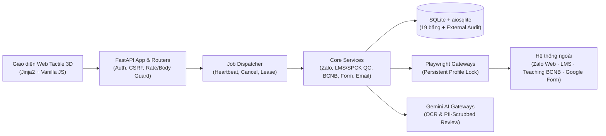

# MindX Auto — Zalo, LMS & BCNB Automation

<p align="left">
  
  
  
  
  
  
  
</p>

**MindX Auto (`zaloAutomation`)** là hệ thống vận hành cục bộ trên Windows hỗ trợ kiểm tra báo cáo giảng dạy, kiểm định chất lượng nhận xét học viên / Sản Phẩm Cuối Khóa (SPCK), đồng bộ trạng thái bảng kiểm tra nhận xét (**Teaching / BCNB**) và tự động hóa điền **Google Form** theo triết lý **Fail-Closed** (luôn xem trước, kiểm chứng bằng chứng rõ ràng, lưu vết kiểm toán và không bao giờ suy đoán khi dữ liệu mơ hồ).

---

## Tính năng cốt lõi

### 1. Quét Báo Cáo Zalo & Kiểm Định Chất Lượng LMS / SPCK
- **Dò kế hoạch 2 tuần (`Auto Discovery`)**: Thu thập bảng lớp học trên Teaching (`BCNB`), đối chiếu danh sách nhóm lớp Zalo theo mã lớp chuẩn, phát hiện dòng thiếu/mơ hồ (`dropped_rows`) và đóng băng snapshot bất biến trước khi quét.
- **Quét Zalo có bằng chứng hình ảnh**: Phân loại báo cáo buổi học theo luật kết hợp AI gợi ý có kiểm soát, chụp ảnh minh chứng độ nét cao (`2x`, hỗ trợ phóng to `100% / 185% / 260%`), tự động hoãn các buổi chưa kết thúc giờ học (`⏳ Chưa tới giờ kiểm tra`), hỗ trợ **Quét lại chọn lọc (`Selective Re-scan`)** cho các lớp nộp bù và **Duyệt tay 1-Click** gắn chữ ký `SHA-256` của ảnh bằng chứng.
- **Kiểm định nội dung LMS & SPCK khử PII**:
  - Truy vấn hàng loạt dữ liệu buổi học, điểm danh và bài nộp SPCK (Buổi 12–14) từ LMS; chấm chất lượng nhận xét qua **Phễu 2 tầng (Rule + Gemini AI)** với cơ chế khử thông tin định danh học viên (`[HS]`, `[URL]`, `[EMAIL]`, `[PHONE]`) ngay trên trình duyệt trước khi đưa về máy chủ.
  - Phân biệt quy tắc Buổi thường, Buổi Checkpoint (`Coding` B5/B9, `Robotics` B4/B8), quy tắc nộp SPCK theo sĩ số đi học thực tế (`ATTENDED` / `LATE_ARRIVED`), đặc thù khối `Robotics` và các khóa được miễn SPCK (`PTB` / `CSB`).
- **Tự động cập nhật BCNB có đọc ngược (`Read-back Verification`)**: Tách biệt độc lập thao tác tích checkbox và thao tác cập nhật cột `Mô tả vấn đề (TE/TF/QC)`, bảo toàn nguyên vẹn ghi chú thủ công của QC và xác minh lại dữ liệu trên DOM sau khi lưu.

### 2. Tra Cứu Lịch Sử Tuần, Xuất CSV Lỗi & Gửi Email Quản Lý
- **Tổng hợp tuần chuẩn xác**: Hợp nhất kết quả quét nền, các lượt quét lại chọn lọc cùng snapshot và lịch sử duyệt tay theo đúng khóa buổi học.
- **Phân cấp mức độ cảnh báo trực quan**:
  - **Mức Đỏ (`❌`)**: Chưa gửi báo cáo Zalo (`❌ Chưa nhận xét`) hoặc chưa hoàn tất nhận xét buổi học trên LMS.
  - **Mức Cảnh báo Vàng (`⚠️`)**: Chưa nộp SPCK hoặc SPCK chưa có nhận xét trong bảng Email Quản lý, kèm danh sách nhắc nhở chi tiết từng hạng mục QC.
- **Đa định dạng xuất bản**: Xuất file CSV chuẩn `UTF-8 BOM` mở trực tiếp bằng Excel, bảng HTML tương thích Webmail doanh nghiệp / Gmail, sao chép nhanh danh sách nhắc giảng viên 1-Click và gửi SMTP TLS có kiểm soát `allowlist` người nhận.

### 3. Đối Chiếu & Tích LMS Tự Động
- Quét trực tiếp danh sách lớp quá hạn điểm danh / nhận xét trên Web LMS (hoặc từ ảnh chụp), đối chiếu với bảng BCNB tuần hiện tại để dựng bảng xem trước **Dự kiến tick** vs **Không tick**.
- Cho phép chọn/bỏ chọn từng lớp, khóa toàn vẹn kế hoạch bằng mã băm dùng một lần (`plan_digest` + `selection_digest`) trước khi thực thi.

### 4. Trích Xuất Học Viên & Điền Google Form
- Lấy trực tiếp danh sách học viên theo mã lớp từ LMS hoặc trích xuất qua OCR Gemini từ ảnh danh sách lớp.
- Hỗ trợ cấu hình ánh xạ câu hỏi (`Q&A Mapping`), câu hỏi trắc nghiệm / dropdown, khóa chống gửi trùng (`idempotency`), giới hạn tốc độ và lưu ảnh chụp biểu mẫu đã ẩn danh tên học viên.

---

## Kiến trúc tổng quan



| Thành phần | Công nghệ sử dụng |
|---|---|
| **Backend & API** | Python `3.14`, FastAPI `0.136`, Uvicorn `0.49` (`43` HTTP routes) |
| **Tự động hóa trình duyệt** | Playwright `1.60` (Chromium, persistent profile + file lock độc quyền) |
| **AI & Xử lý ngôn ngữ/ảnh** | Google Gemini (`google-genai`), kết hợp bộ phân loại luật tất định |
| **Cơ sở dữ liệu** | SQLite (`aiosqlite`), migration có kiểm tra checksum, sao lưu nóng & diễn tập khôi phục |
| **Giao diện người dùng** | Jinja2 Templates, Vanilla JavaScript, Tactile High-Contrast UI (WCAG AA) |
| **Kiểm định chất lượng** | `unittest` (`719` tests), `coverage` (`78.9%` branch), `ruff`, `mypy` (`78` files), Node JS contract check |

---

## Cấu trúc thư mục

```text
zaloAutomation/
├── main.py                     # Khởi tạo FastAPI app, middleware bảo mật & gắn routers
├── api/                        # 10 module HTTP routes (Zalo, LMS, Google Form, Jobs, Auth, Health...)
├── core/                       # Cấu hình bất biến, DI Container, phân quyền RBAC & kiểm tra readiness
├── services/                   # Nghiệp vụ cốt lõi (quét Zalo, chấm LMS/SPCK, ghi BCNB, gửi Email, Dispatcher)
├── classifiers/                # Bộ phân loại tin nhắn báo cáo Zalo theo luật & trích xuất ngày/buổi
├── googleform_autosubmit/      # Cấu hình môi trường, OCR danh sách lớp & trình điền Google Form
├── repositories/               # Truy cập dữ liệu SQLite (jobs, snapshots, reports, external_action_audit)
├── db/                         # Quản lý schema, migrations, sao lưu nóng & kiểm tra khôi phục
├── templates/ & static/        # Giao diện Dashboard 4 khu vực, CSS Tactile 3D & JavaScript frontend
├── scripts/                    # Khởi chạy local, kiểm tra bảo mật/bí mật, sao lưu & công cụ vận hành
├── tests/                      # 719 bài kiểm thử tự động & các cổng kiểm tra hợp đồng giao diện/kiến trúc
├── START.bat                   # Script khởi động nhanh ứng dụng trên Windows
├── DANG_NHAP_ZALO.bat          # Script mở hồ sơ trình duyệt để đăng nhập sẵn Zalo Web
└── CHECK_QUALITY.ps1           # Cổng kiểm định chất lượng toàn diện (chế độ cô lập -Isolated)
```

---

## Cài đặt & Khởi chạy nhanh (Windows)

### 1. Chuẩn bị môi trường
Yêu cầu **Python 3.14** và **Node.js** (phục vụ kiểm tra hợp đồng JavaScript giao diện):

```powershell
python -m venv venv
.\venv\Scripts\python.exe -m pip install -r requirements.lock.txt
.\venv\Scripts\python.exe -m playwright install chromium
```

### 2. Cấu hình biến môi trường
Sao chép tệp mẫu `.env.example` thành `.env` và điền thông tin vận hành cục bộ (tuyệt đối không đưa `.env` lên Git):

```powershell
Copy-Item .env.example .env
```

> **Lưu ý an toàn mặc định**: Giữ `BCNB_DRY_RUN=true` và `GOOGLE_FORM_MODE=dry-run` khi chạy thử nghiệm để hệ thống chỉ lập kế hoạch và mô phỏng mà không ghi ra hệ thống ngoài.

### 3. Đăng nhập phiên Zalo & Khởi động ứng dụng
1. Chạy `DANG_NHAP_ZALO.bat` trong lần đầu tiên để quét mã QR đăng nhập Zalo Web vào hồ sơ trình duyệt cục bộ, sau đó đóng cửa sổ trình duyệt.
2. Chạy `START.bat` (hoặc `.\venv\Scripts\python.exe -m scripts.run_local`).
3. Mở trình duyệt tại `http://127.0.0.1:8000` và kiểm tra trạng thái sẵn sàng tại `http://127.0.0.1:8000/api/health/ready` (`"ready": true`).

> Kiến trúc hiện tại được thiết kế cho **một tiến trình ứng dụng duy nhất** trên máy vận hành nhằm bảo vệ khóa hồ sơ trình duyệt (`zalo-profile.lock`) và cơ sở dữ liệu SQLite.

---

## Kiểm tra chất lượng mã nguồn

Chạy toàn bộ cổng kiểm tra chất lượng trong môi trường cô lập hoàn toàn (dùng dữ liệu tạm, tự động chặn trình duyệt thật, Gemini thật và SMTP thật):

```powershell
powershell -ExecutionPolicy Bypass -File .\CHECK_QUALITY.ps1 -Isolated
```

Kiểm tra nhanh hợp đồng JavaScript giao diện hoặc kiểm tra rò rỉ bí mật:

```powershell
node tests/check_template_js.js
.\venv\Scripts\python.exe -X utf8 -B -m scripts.phase9a_audit
```

---

## Nguyên tắc an toàn dữ liệu & vận hành

1. **Bảo vệ dữ liệu nhạy cảm & PII**: Không bao giờ lưu `.env`, `database.db`, `runtime/`, `zalo_session/`, ảnh chụp minh chứng thật hoặc thông tin cá nhân học viên vào Git. Nội dung nhận xét gửi qua AI đều được khử PII tự động hai lớp.
2. **Fail-Closed trước dữ liệu mơ hồ**: Lịch sử Zalo chưa đồng bộ đủ, mã lớp trùng/thiếu hoặc phản hồi mạng bất thường đều được giữ ở trạng thái `Cần kiểm tra thủ công` (`CATEGORY_REVIEW`), không tự động suy diễn hay ghi đè.
3. **Xem trước & Lưu vết kiểm toán (`Audit Trail`)**: Mọi thao tác cập nhật ra bên ngoài (BCNB/Teaching, LMS, Google Form, Email) đều ghi nhận ý định vào `external_action_audit`, không tự phát lại mù quáng các tác vụ production bị gián đoạn và luôn hỗ trợ sao lưu SQLite trước khi nâng cấp.

---

## Tài liệu dự án

- [PROJECT_SUMMARY.md](PROJECT_SUMMARY.md) — Đặc tả kiến trúc, luồng dữ liệu và hợp đồng nghiệp vụ tổng quan.
- [PROJECT_STATE.md](PROJECT_STATE.md) — Snapshot ngắn gọn về trạng thái kiểm chứng gần nhất và lưu ý vận hành mở.
- [CHANGELOG.md](CHANGELOG.md) — Nhật ký chi tiết lịch sử phát triển tính năng và các bản vá kỹ thuật.
- [PROJECT_DECISIONS.md](PROJECT_DECISIONS.md) — Sổ ghi nối tiếp các quyết định kiến trúc, an toàn và quy trình (`DEC-001` → nay).
- [CLASS_LIFECYCLE.md](CLASS_LIFECYCLE.md) — Quy tắc nghiệp vụ về vòng đời mã lớp và khóa học.
- [AGENTS.md](AGENTS.md) — Quy tắc điều phối và cổng kiểm chứng dành cho lập trình viên & AI Agent.
